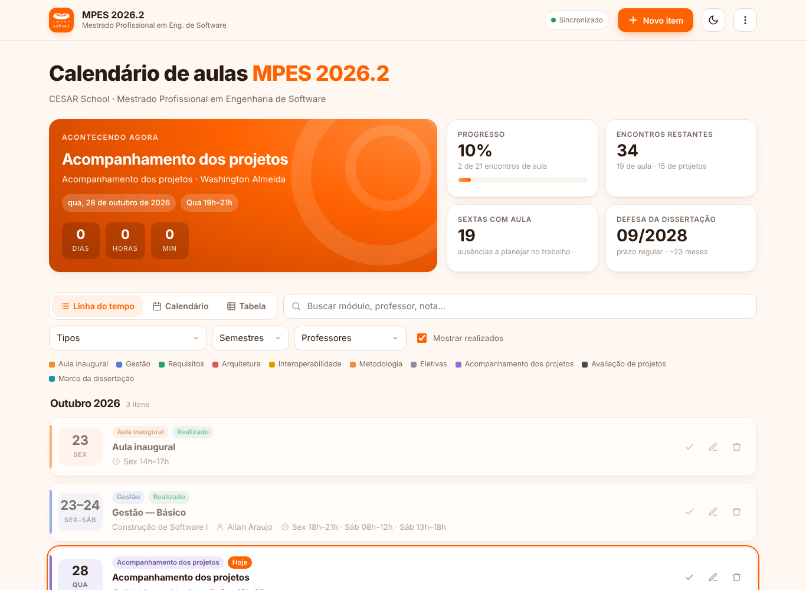
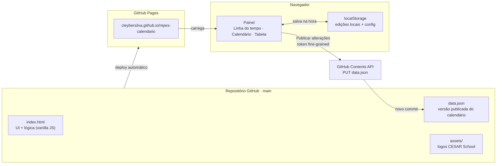

<div align="center">

# 📅 mpes-calendario

### Calendário vivo das aulas do Mestrado Profissional em Engenharia de Software da CESAR School (turma MPES 2026.2), editável no navegador e publicado no GitHub Pages

[](https://cleybersilva.github.io/mpes-calendario/)
[](index.html)
[](index.html)
[](index.html)
[](https://www.cesar.school)

[](data.json)
[](#️-uso)
[](#-arquitetura)
[](#️-uso)
[](#-segurança)

[Sobre](#-sobre-o-projeto) •
[Arquitetura](#-arquitetura) •
[Funcionalidades](#-funcionalidades) •
[Instalação](#-instalação) •
[Uso](#️-uso) •
[Sincronização](#-sincronização-com-o-github) •
[Segurança](#-segurança) •
[Calendário](#-calendário-2026-2027) •
[Autor](#-autor)

**🌐 Acesse: [cleybersilva.github.io/mpes-calendario](https://cleybersilva.github.io/mpes-calendario/)**

---

</div>

## 📖 Sobre o Projeto

**mpes-calendario** é uma página estática que transforma o PDF do calendário
do **MPES 2026.2 (CESAR School)** num painel vivo: dá para adicionar, editar,
duplicar, marcar como concluído e excluir encontros direto no navegador, ver
o próximo encontro com contagem regressiva e acompanhar o progresso do curso
até a defesa da dissertação. Tudo cabe em um único `index.html` mais um
`data.json`: sem build, sem framework, sem backend.

### 🧩 O problema que isto resolve

O calendário oficial chega em PDF, marcado como "em construção", e muda ao
longo do semestre: professor a definir, data remanejada, eletiva confirmada
depois. Um PDF não deixa anotar leituras, marcar o que já passou nem ver
rapidamente quantas sextas de aula ainda vêm pela frente. Para quem trabalha
em horário comercial e precisa negociar a saída nas sextas, isso conta. Esta
página resolve as duas coisas: mantém o calendário editável e mostra o que
importa para o planejamento, no celular ou no computador.



## 🏗️ Arquitetura



1. **Carga**: a página busca o `data.json` publicado e compara com a cópia
   do `localStorage` pelo campo `meta.updatedAt`. Vence a mais recente.
2. **Edição**: toda alteração grava na hora no `localStorage`. O selo no
   topo indica **"Alterações não publicadas"** enquanto a versão local
   diferir da publicada.
3. **Publicação**: pelo menu **⋮ › Publicar alterações no GitHub**, a página
   faz um `PUT` na Contents API e grava o `data.json` como um novo commit.
   O GitHub Pages reconstrói o site em 1 a 2 minutos.

| Arquivo | Papel |
| --- | --- |
| `index.html` | Interface, estilos e lógica, em um único arquivo |
| `data.json` | Fonte publicada dos itens (`meta` + `items`) |
| `assets/logo-cesar.png` | Logo e favicon |
| `docs/` | Capturas usadas neste README |
| `.nojekyll` | Serve os arquivos como estão, sem processamento Jekyll |

## ✨ Funcionalidades

| Recurso | Detalhe |
| --- | --- |
| CRUD completo | Adicionar, editar, duplicar, concluir e excluir, com **desfazer** |
| Três visualizações | Linha do tempo por mês, calendário mensal e tabela ordenável |
| Busca e filtros | Por texto, tipo, semestre e professor; opção de ocultar realizados |
| Próximo encontro | Cartão com data, turnos e contagem regressiva |
| Indicadores | Progresso do curso, encontros restantes, sextas com aula e prazo da defesa |
| Agenda | Exporta `.ics` com cada turno como evento (fuso America/Recife) |
| Backup | Baixa e importa o calendário em JSON |
| Tema | Claro e escuro, seguindo o sistema ou escolhido manualmente |
| Responsivo | Layout próprio para celular, com botão flutuante "+" |
| Atalho | Tecla `n` abre um novo item |

## 🚀 Instalação

Não há build. Para rodar localmente:

```bash
git clone https://github.com/cleybersilva/mpes-calendario.git
cd mpes-calendario
python3 -m http.server 8080
```

Abra **http://localhost:8080/**. Use um servidor local em vez de abrir o HTML
como arquivo, porque o `fetch('data.json')` não funciona via `file://`.

O deploy usa **Settings › Pages › Deploy from a branch › `main` / `(root)`**.
Cada push na `main` atualiza o site.

## ▶️ Uso

| Ação | Como |
| --- | --- |
| Novo item | Botão **Novo item**, botão **+** no celular, tecla `n` ou clique num dia do calendário |
| Ver detalhes | Clique no cartão, na linha da tabela ou no evento do calendário |
| Editar / excluir | Ícones ✏️ e 🗑️ no cartão, ou dentro do formulário |
| Concluir | Ícone ✓ (alterna entre "Concluído" e status automático pela data) |
| Exportar agenda | **⋮ › Exportar para agenda (.ics)** e importar no Google Calendar ou Outlook |
| Backup | **⋮ › Baixar backup (JSON)** / **Importar backup (JSON)** |
| Voltar ao publicado | **⋮ › Descartar alterações locais** |

Cada item segue este formato no `data.json`:

```json
{
  "id": "i002",
  "titulo": "Gestão — Básico",
  "modulo": "Construção de Software I",
  "categoria": "gestao",
  "inicio": "2026-10-23",
  "fim": "2026-10-24",
  "horarios": ["sex2", "sab1", "sab2"],
  "professor": "Allan Araujo",
  "modalidade": "presencial",
  "semestre": 1,
  "local": "CESAR School",
  "notas": "",
  "status": "auto"
}
```

**Categorias:** `inaugural`, `gestao`, `requisitos`, `arquitetura`,
`interoperabilidade`, `metodologia`, `eletiva`, `acompanhamento`,
`avaliacao`, `marco`, `outro`.

**Turnos (`horarios`):** `qua` (Qua 19h–21h), `sex1` (Sex 14h–17h), `sex2`
(Sex 18h–21h), `sab1` (Sáb 08h–12h), `sab2` (Sáb 13h–18h).

## 🔄 Sincronização com o GitHub

As edições ficam no navegador onde foram feitas. Para que apareçam em
qualquer dispositivo:

1. No GitHub: **Settings › Developer settings › Personal access tokens ›
   Fine-grained tokens › Generate new token**.
2. Em *Repository access*, escolha **Only select repositories ›
   `mpes-calendario`**.
3. Em *Permissions*, defina **Contents: Read and write**. Nenhuma outra
   permissão é necessária.
4. Na página: **⋮ › Configurar sincronização GitHub**, cole o token
   (usuário e repositório já vêm preenchidos) e salve.
5. Depois de editar: **⋮ › Publicar alterações no GitHub**.

## 🔒 Segurança

O token fica **somente no `localStorage` do navegador** em que foi
configurado: nunca entra no repositório nem em URL, e só é enviado para
`api.github.com`. Use um token **fine-grained, restrito a este repositório e
com prazo de expiração**. O botão **Esquecer token** apaga o token do
navegador. Todo texto exibido passa por escape de HTML, então nada digitado
num item é executado como código. Como o repositório é público (requisito do
GitHub Pages gratuito), **não registre dados sensíveis** nas anotações.

## 🗓️ Calendário 2026-2027

Fonte: *Calendário MPES 2026.2 (em construção)*, atualizado em 21/10/2026.

| Período | Módulo | Professor(a) |
| --- | --- | --- |
| 23/10/2026 | Aula inaugural | — |
| 23–24/10/2026 | Construção de Software I · Gestão (Básico) | Allan Araujo |
| 06–07/11/2026 | Construção de Software I · Requisitos (Básico) | Rodrigo Medeiros |
| 13–14/11/2026 | Construção de Software I · Arquitetura (Básico) | Walter Seiffert (online) |
| 27–28/11/2026 | Construção de Software I · Interoperabilidade (Básico) | Fernando Carvalho |
| 11–12/12/2026 | Construção de Software II · Gestão (Intermediário) | Suzanna Sandes |
| 18–19/12/2026 | Construção de Software II · Requisitos (Intermediário) | Allan Araujo |
| 08–09/01/2027 | Construção de Software II · Arquitetura (Intermediário) | Carlos Diego |
| 22–23/01/2027 | Construção de Software II · Interoperabilidade (Intermediário) | A definir |
| 19–20/02/2027 | Construção de Software III · Gestão (Avançado) | Suzanna Sandes |
| 26–27/02/2027 | Construção de Software III · Requisitos (Avançado) | Aêda Sousa |
| 12–13/03/2027 | Construção de Software III · Interoperabilidade (Avançado) | Milton Lima |
| 02–03/04/2027 | Construção de Software III · Arquitetura (Avançado) | Carlos Diego |
| 21–22/05/2027 | Metodologia · Parte 1 | Gustavo (online) |
| 04–05/06/2027 | Eletivas · Parte 1 | — |
| 18–19/06/2027 | Metodologia · Parte 2 | Danilo |
| 09–10/07/2027 | Eletivas · Parte 2 | — |
| 30–31/07/2027 | Metodologia · Parte 3 | Danilo |
| 13–14/08/2027 | Metodologia · Parte 4 | Gustavo (online) |
| 27–28/08/2027 | Eletivas · Parte 3 | — |
| 17–18/09/2027 | Eletivas · Parte 4 | — |

**Quartas (19h–21h):** acompanhamento dos projetos com Washington Almeida e
avaliações de projetos SR1 (17/02/2027), SR2 (19/05/2027) e SR3 (29/07/2027).

**Dissertação:** acompanhamento I de set/2027 a mar/2028, qualificação até
30/03/2028, acompanhamento II de abr/2028 a set/2028 e **defesa até
30/09/2028** (tempo regular).

## 📘 Glossário

| Termo | Significado |
| --- | --- |
| MPES | Mestrado Profissional em Engenharia de Software (CESAR School) |
| Encontro | Bloco de aulas de um módulo, normalmente sexta à tarde/noite e sábado o dia todo |
| SR | Sessão de avaliação de projetos (SR1, SR2, SR3) |
| Marco | Etapa da dissertação com prazo (qualificação, defesa) |
| Publicado | Versão do `data.json` que está no repositório e no site |
| Local | Edições salvas só no navegador, ainda não publicadas |

## 🗺️ Roadmap

- Atualizar os dados a cada nova versão do PDF da coordenação.
- Registrar as eletivas escolhidas e seus professores quando forem definidos.
- Incluir salas e links das aulas online à medida que forem divulgados.

---

## 👤 Autor

<div align="center">


### **Cleyber Gomes da Silva**

**AI Scientist / SRE Engineer** · TCS × Itaú Unibanco
**Aluno de MBA em Inteligência Artificial e Big Data** · ICMC / USP
**Mestrando em Engenharia de Software** · CESAR School · **Doutorando em Ciências da Educação** · VCCU

📍 João Pessoa, Paraíba, Brasil

[](https://github.com/cleybersilva)
[](https://linkedin.com/in/cleyber-silva)

</div>

### Sobre o autor

AI Scientist / SRE Engineer com experiência em ambientes bancários regulados,
atualmente alocado ao **Itaú Unibanco** via **TCS (Tata Consultancy
Services)**. Simultaneamente, mestrando em **Engenharia de Software** pela
**CESAR School** e doutorando em **Ciências da Educação** pela **VCCU (Veni Creator
Christian University)**, onde também atua como professor, pesquisador e
gestor do VLE (Moodle).

Especialista em **RPA → hyperautomation**, **GitOps**, **Observability** e
**AI aplicada a operações**. O **mpes-calendario** nasceu da necessidade
prática de conciliar o mestrado com a rotina de trabalho: saber de antemão
quais sextas exigem ausência, o que vem no próximo encontro e quanto falta
para a defesa, sem depender de um PDF estático.

**Formação simultânea:**
- 🎓 MBA em Inteligência Artificial e Big Data — ICMC/USP
- 🎓 Mestrado em Engenharia de Software — CESAR School
- 🎓 Doutorado em Ciências da Educação — VCCU
- 🎓 Pós-graduações concorrentes em DevOps, Cloud Architecture, SRE e .NET/Azure

---

<div align="center">

### ⭐ Se este projeto foi útil, considere dar uma estrela!

**Feito com ❤️ para não perder nenhuma sexta de aula no CESAR**

---

**mpes-calendario** · Calendário vivo · CESAR School · MPES 2026.2

[⬆ Voltar ao topo](#-mpes-calendario)

---

_"O PDF diz quando; o painel lembra o que fazer com cada data."_

© 2026 · Cleyber Gomes da Silva

</div>
